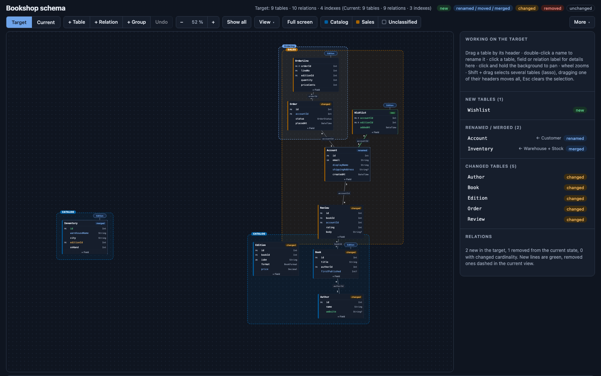
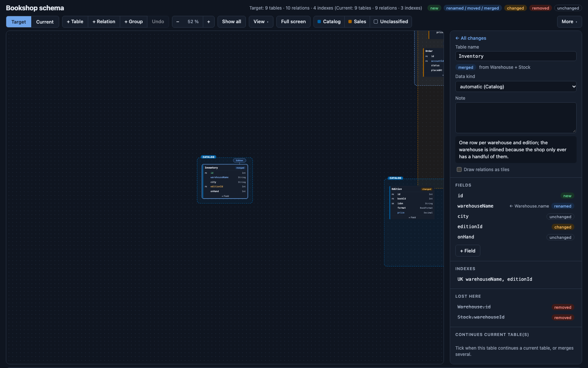

# schema-canvas

**Turn a database schema into one self-contained, interactive ER diagram, and review the current schema against a target schema together with people who do not read SQL.**

[](LICENSE)
[](package.json)



```
Prisma schema ─┐
               ├─► model.json ─► schema-canvas build ─► page.html (no server, no CDN, works offline)
tbls JSON ─────┘    (+ target.model.json, layout.json, config.json)
```

## Why

Schema changes are usually reviewed as migration files, which only developers can read. Product owners,
analysts and domain experts need to see *what the data model will look like afterwards* and *what changes*.

schema-canvas renders the current schema and a proposed target schema as the same diagram and colours the
difference: new, removed, renamed, merged, moved and changed tables, fields and relations. The target model
is editable in the browser, so a review meeting can change it live. The output is a single HTML file you can
mail, host anywhere or open from disk.



## Features

- **Diff colouring** between current and target model, based on explicit `origin` references (no guessing from names).
- **Editing the target model**: rename tables and fields (double-click), add tables, fields, relations and
  groups, edit types, keys, defaults, notes, data kinds, modules and origins, move fields between tables, undo.
- **Data kinds**: colour tables by kind (for example "catalog" vs. "sales"), draw background zones per kind,
  hide kinds with filter buttons.
- **Three automatic layouts**: by relations (stress layout, few crossings), as a star around one table, and by data kind.
- **Review support**: tick tables as reviewed and dim them; mark fields whose content changes although their type does not.
- **Text sections and translations**: a description and markdown sections (decisions, open questions) from
  `config.json`; every interface text can be replaced, for example to translate the page.
- **Tile mode** per table: relations to a busy hub table are drawn as small name tiles or as a badge
  "-> Table" on the foreign-key field instead of long lines.
- **Module view**: one box per module with the number of foreign keys between modules; layer rules from
  `dependsOn` mark forbidden directions and cycles in red and arrange the boxes in layers. Shows schema (FK)
  coupling only; opaque references (no foreign key) can be hidden.
- **Storage**: browser localStorage, JSON file export / import, or a shared claude.ai artifact database, with a
  keep-mine / take-theirs conflict dialog.
- Index display, enum list, inspector for tables, fields and relations, lasso multi-select, full screen,
  keyboard panning, light and dark theme.

Without a target model the page is a pure viewer (no diff, no editing).

## Quick start

Requires Node.js 20 or newer.

```sh
git clone https://github.com/CodeOfRob/schema-canvas.git
cd schema-canvas
npm install
npm run example        # builds examples/bookshop/out/page.html
open examples/bookshop/out/page.html
```

Without cloning (the first run installs the dependencies, the Prisma parser is the largest):

```sh
npx github:CodeOfRob/schema-canvas build --prisma prisma/schema.prisma -o schema.html
```

From a clone, `node bin/schema-canvas.mjs <command>` works the same way; `npm link` provides the
`schema-canvas` command.

Your own schema:

```sh
# 1. schema -> model.json
schema-canvas model --prisma prisma/schema.prisma -o current.model.json
# or, for any database tbls supports (PostgreSQL, MySQL, SQLite, ...):
tbls out -t json -o schema.json postgres://...
schema-canvas model --tbls schema.json -o current.model.json

# 2. model.json -> page.html (viewer only)
schema-canvas build --current current.model.json -o page.html

# 3. with a target model, saved layout and configuration
schema-canvas build --current current.model.json --target target.model.json \
  --layout my.layout.json --config config.json -o page.html
```

`build` also accepts `--prisma` or `--tbls` directly instead of `--current`. Full reference: [docs/cli.md](docs/cli.md).

## Concepts

- **Current and target model.** Both use the same `model.json` format. The target describes the schema you
  want; the page diffs it against the current one.
- **Origin.** Every target table or field can name the current parts it continues: absent = the same-named
  counterpart, `[]` = new, another name = renamed (or moved), several = merged. See [docs/model-format.md](docs/model-format.md).
- **Data kinds.** Labels such as "catalog" or "sales" that colour tables and form zones. Configured in `config.json`.
- **Modules.** Which part of the system owns a table, apart from its data kind and from layout groups. Set
  per table (`module`) or by name in `config.json`; the module view folds the tables into one box per module.
- **Tile tables.** Hub tables whose relations are drawn as tiles or badges. Configured in `config.json`, switchable per viewer.
- **Layout file.** Table positions and groups live in `layout.json`, apart from the model, so regenerating a
  model never wipes them. **More -> Export layout** in the page writes it. See [docs/config.md](docs/config.md).

## Hosting

The page is one HTML file with no external requests:

- open it from disk,
- put it on any static host (GitHub Pages, S3, an intranet server, a mail attachment),
- or use it as a claude.ai artifact, where edits are shared live between everyone with the page.

As a claude.ai artifact, declare the capabilities `db` (shared storage) and `downloads` (file export).

How edits are saved in each case: [docs/storage.md](docs/storage.md).

## Limitations

- Prisma: native database types (`@db.VarChar(20)`), `@map` / `@@map` names, views and composite types
  are not shown; the Prisma type is used.
- tbls: views and materialized views are skipped; check constraints and triggers are not shown.
- The relation layout compares every pair of tables; beyond a few hundred tables it gets slow.
- The page renders all tables as DOM elements; very large schemas (1000+ tables) will feel heavy.
- No collaborative merging: the conflict dialog picks one whole state.

## Documentation

- [docs/cli.md](docs/cli.md) - commands and options
- [docs/model-format.md](docs/model-format.md) - `model.json`, origins, relations
- [docs/config.md](docs/config.md) - `config.json`, `layout.json`, data kinds, modules, tile tables
- [docs/storage.md](docs/storage.md) - storage modes, snapshot format, conflict rule
- [docs/adapters.md](docs/adapters.md) - Prisma, tbls, writing a new adapter
- [docs/architecture.md](docs/architecture.md) - module map and data flow

## Contributing

This is a personal project: issues and pull requests are not accepted here, but you are welcome to fork it.
How to build and test the code is described in [CONTRIBUTING.md](CONTRIBUTING.md). Changes are listed in [CHANGELOG.md](CHANGELOG.md).

## License

MIT, see [LICENSE](LICENSE).
